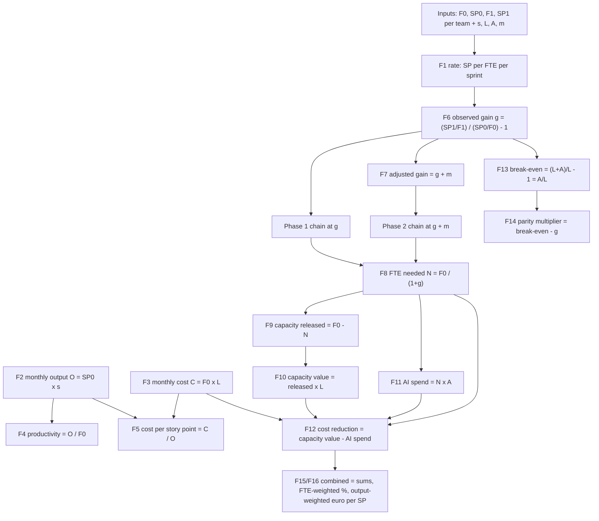

# AI Productivity & Cost-Reduction Calculator — Complete Calculation Reference

> **Tool documented:** `ai-two-team-evidence-dashboard.html` (two-team evidence edition, v2)
> **What this document is:** every calculation in the HTML tool, with the mathematical formula, a worked example on the default numbers, and an explicit account of **why each result is + or −** — from the productivity perspective and from the cost perspective. Written for presenting: keep it beside the open dashboard while you demo.
> **Companions:** `AI_Two_Team_Evidence_Report.md` (the evidence analysis) · `AI_Two_Team_Calculator_Guide.md` (the field-by-field user guide) · this reference (the math, the examples, and the +/− reasoning)
> **Reproducibility:** every number below is produced by the tool's own defaults. In the dashboard, press **Reset to evidence defaults** and every figure in this document appears on screen exactly as printed here.

---

## Contents

**Part I — The calculation, formula by formula**

1. [The model in sixty seconds](#1-the-model-in-sixty-seconds)
2. [Notation, inputs and the calculation pipeline](#2-notation-inputs-and-the-calculation-pipeline)
3. [Foundation metrics — F1 to F5](#3-foundation-metrics--f1-to-f5)
4. [The gain formulas — F6 (measured) and F7 (projected)](#4-the-gain-formulas--f6-measured-and-f7-projected)
5. [The same-output costing chain — F8 to F12](#5-the-same-output-costing-chain--f8-to-f12)
6. [The two thresholds — F13 break-even and F14 tool parity](#6-the-two-thresholds--f13-break-even-and-f14-tool-parity)
7. [Combined and portfolio math — F15, F16, KPI strip, scenario grid](#7-combined-and-portfolio-math--f15-f16-kpi-strip-scenario-grid)
8. [Every default number, table by table](#8-every-default-number-table-by-table)

**Part II — Why the results are + or −**

9. [The productivity perspective — what makes the gain + or −](#9-the-productivity-perspective--what-makes-the-gain--or-)
10. [The cost perspective — what makes the euro result + or −](#10-the-cost-perspective--what-makes-the-euro-result--or-)
11. [Where the model is deliberately conservative, and where it could overstate](#11-where-the-model-is-deliberately-conservative-and-where-it-could-overstate)

**Part III — Presenting it**

12. [Answering the room — twelve questions you will be asked](#12-answering-the-room--twelve-questions-you-will-be-asked)
13. [The five-minute demo script](#13-the-five-minute-demo-script)
14. [Appendix — formula cheat sheet, conventions, glossary](#14-appendix--formula-cheat-sheet-conventions-glossary)

---

## 1. The model in sixty seconds

The calculator answers two questions about two delivery teams, using one disciplined method. **Question one (productivity):** did each engineer deliver more or less after AI arrived, measured per FTE so that headcount changes cannot fake the answer? **Question two (cost):** delivering the *same baseline monthly output* at the *adjusted efficiency*, does the organization spend more or fewer euros per month — after paying for the AI seats needed to do it?

The method has two phases that must never be summed, because they are two estimates of the same quantity at two maturity levels. **Phase 1** uses only what was *measured*: each team is observed in a without-AI sprint and a with-AI sprint, the per-FTE delivery rate is compared, and the observed gain is priced through a same-output costing chain. **Phase 2** asks what a *structured* AI programme should add on top: an industry multiplier — default **+8.69%, the Accenture × GitHub enterprise randomized controlled trial** — is added to the observed gain, and the identical costing chain is re-run.

Six headline numbers tell the whole default story, and they are the six KPI cards at the top of the page: Team 1's observed per-FTE gain **+5.0%**; Team 2's **−2.1%**; the cost break-even every gain must beat **+8.33%** (because a €100 AI seat sits on top of €1,200 of monthly labour); the Phase 2 combined gain **+9.4%**; the capacity released by that projection **+1.31 FTE** per month; and the combined cost reduction after tool spend **+€157 per month (+0.8% of the €18,600 baseline)**. The tension between those cards — two measured gains that do not yet clear the seat-price hurdle, and a projection that barely does — is exactly the conversation this tool is designed to make honest and easy to have.

---

## 2. Notation, inputs and the calculation pipeline

### 2.1 Notation

| Symbol | Meaning | Default (Team 1 / Team 2) |
|--------|---------|---------------------------|
| `F₀` | FTE headcount in the baseline (before-AI) sprint | 6.0 / 9.5 |
| `SP₀` | Story points delivered in the baseline sprint | 58.6 / 66.8 |
| `F₁` | FTE headcount in the observed with-AI sprint | 5.5 / 11.5 |
| `SP₁` | Story points delivered in the with-AI sprint | 56.4 / 79.2 |
| `s` | Sprints per month (the operating unit of the cost model) | 2 |
| `L` | Fully loaded labour cost per FTE per month, € | 1,200 |
| `A` | AI seat cost per FTE per month, € (licence + usage) | 100 |
| `m` | Industry multiplier applied in Phase 2 | 8.69% |
| `g` | The gain being costed — observed `g` (F6) in Phase 1, adjusted `g_adj` (F7) in Phase 2 | per phase |
| `O` | Baseline monthly output in story points (F2) | derived |
| `C` | Baseline monthly cost, € (F3) | derived |
| `N` | FTE-months needed to deliver `O` at the gain being costed (F8) | derived |

### 2.2 The fourteen inputs

| # | Field | Default | Where the value comes from |
|---|-------|---------|----------------------------|
| 1 | Team 1 name | Team 1 | Free text |
| 2 | Team 1 · FTE before AI | 6.0 | Sprint tracking: headcount in the baseline sprint |
| 3 | Team 1 · Story points before AI | 58.6 | The team's own estimation, unchanged |
| 4 | Team 1 · FTE with AI | 5.5 | Headcount in the observed with-AI sprint |
| 5 | Team 1 · Story points with AI | 56.4 | Story points delivered in that sprint |
| 6–10 | Team 2 · same five fields | 9.5 / 66.8 / 11.5 / 79.2 | Same definitions |
| 11 | Sprints per month | 2 | Cadence: two-week sprints → 2 |
| 12 | Labour cost per FTE / month | €1,200 | Finance: fully loaded (salary + employer costs + overhead) |
| 13 | AI seat cost per FTE / month | €100 | Licence + usage per AI-enabled engineer |
| 14 | Industry multiplier (slider) | +8.69% | Phase 2 uplift; presets 8.69 / 10 / 15 / 20 / 25 / 30% |

Three hygiene rules keep these inputs trustworthy, and they are worth stating in any demo. The two states must be like-for-like *within each team* — same estimation practice, comparable scope mix. FTE counts must be honest fractions (a half-time engineer is 0.5, not 1). And one sprint per state is a *direction*, not a rate: prefer a rolling average of several sprints before treating the observed gain as settled.

### 2.3 The pipeline



Read the diagram as two branches from the same evidence: the left branch prices the *measured* gain (Phase 1), the right branch prices the *measured + industry* gain (Phase 2), and both branches flow through one identical costing chain (F8–F12). The thresholds (F13–F14) judge the result, and the combined formulas (F15–F16) roll the two teams up. Every section of the HTML page corresponds to one station of this pipeline, and every on-screen number carries the formula ID that produced it.

### 2.4 The framing decision that explains everything: same-output costing

The tool never compares "what we spend now" with "what we used to spend", and the reason is visible in the default evidence: actual monthly spend *rose* by +€3,500 (Team 1 −€50, Team 2 +€3,550) because Team 2 hired. A spend comparison would blame AI for a hiring decision. Instead, every scenario answers a controlled question: **holding the baseline monthly output O fixed, how many FTE-months does it take to deliver it at the adjusted per-FTE efficiency, and what does that cost including AI seats?** Efficiency is thus isolated from staffing decisions, which is the only fair way to evaluate a tool that changes *how much each person delivers*. The released capacity is treated as capacity to redeploy — roadmap, quality, tech debt — never as an automatic headcount cut.

---

## 3. Foundation metrics — F1 to F5

These five formulas convert raw sprint observations into the units the cost model speaks: a per-sprint delivery rate, a monthly output, a monthly cost, a monthly productivity, and a unit price of delivery. They contain no assumptions at all — they are pure arithmetic on the inputs, which is why the tool can print them as "baseline" rows in Section 1 of the page.

### F1 · Story points per FTE per sprint

```
F1    rate = SP ÷ FTE
```

**Team 1:** 58.6 ÷ 6.0 = **9.77** story points/FTE before AI; 56.4 ÷ 5.5 = **10.25** with AI.
**Team 2:** 66.8 ÷ 9.5 = **7.03** before AI; 79.2 ÷ 11.5 = **6.89** with AI.

**Why this metric exists.** When headcount moves between the two observed sprints — and in this evidence it moved in both teams — raw story-point totals answer nothing. Team 2 delivered 12.4 more story points with AI than before, which sounds like success, but it delivered them with 2.0 more people. Dividing delivery by the people who delivered it is the only comparison that survives a staffing change, and it is the numerator-and-denominator basis of every gain number in the tool. The + and − of F1 are settled entirely by whether delivery grew faster than headcount.

### F2 · Monthly output

```
F2    O = SP₀ × s
```

**Team 1:** 58.6 × 2 = **117.2** story points/month. **Team 2:** 66.8 × 2 = **133.6**. **Combined: 250.8.**

**Why it exists.** The cost model is monthly (labour and seats are paid monthly), so the baseline output the scenarios must deliver is scaled to the month using the team's own cadence. O is the *fixed target* of every scenario: Phase 1 and Phase 2 both ask "what does it cost to deliver *this*?" — which is what makes their results comparable to each other.

### F3 · Monthly cost

```
F3    C = F₀ × L
```

**Team 1:** 6.0 × €1,200 = **€7,200**/month. **Team 2:** 9.5 × €1,200 = **€11,400**. **Combined: €18,600.**

**Why it exists.** C is the reference spend that any cost-reduction figure is measured against. Note carefully: C is priced at *baseline* headcount with *no* AI seats. The scenario cost will be `N × (L + A)` — fewer FTE-months, but each carrying a seat — and the comparison of the two is the entire cost story of the tool.

### F4 · Productivity (story points per FTE per month)

```
F4    Prod = O ÷ F₀        (monthly per-FTE rate)
```

**Team 1:** 117.2 ÷ 6.0 = **19.53** story points/FTE/month. **Team 2:** 133.6 ÷ 9.5 = **14.06**. **Combined: 250.8 ÷ 15.5 = 16.18.**

**Why it exists.** F4 is F1 scaled to the month; it doubles at two sprints per month, and it is the rate the adjusted scenarios recompute as `Prod × (1 + g)`. It is also the unit metric the teams should track every sprint to keep the model honest — the productivity answer is + or − exactly when F1/F4 rises or falls per FTE.

### F5 · Cost per story point

```
F5    CP = C ÷ O
```

**Team 1:** €7,200 ÷ 117.2 = **€61.43**/story point. **Team 2:** €11,400 ÷ 133.6 = **€85.33**. **Combined: €18,600 ÷ 250.8 = €74.16.**

**Why it exists.** CP is the *unit price of delivery* — the number a CFO recognizes. Everything in this model ultimately expresses itself through CP: the break-even F13 is precisely the gain at which CP stops rising, and the adjusted scenarios recompute CP as `(L + A) ÷ (Prod × (1 + g))`. Team 2's higher €85.33 (the same €1,200 buys fewer story points) is why the same multiplier buys Team 2 less absolute capacity than Team 1 — a point that becomes central in the cost perspective (§10).

---

## 4. The gain formulas — F6 (measured) and F7 (projected)

### F6 · Observed gain — the ratio of ratios

```
F6    g = (SP₁ ÷ F₁) ÷ (SP₀ ÷ F₀) − 1
```

Equivalently, in growth terms — a form that makes the +/− mechanics transparent:

```
F6'   g = (1 + output growth) ÷ (1 + headcount growth) − 1
```

**Team 1:** (56.4 ÷ 5.5) ÷ (58.6 ÷ 6.0) − 1 = 10.25 ÷ 9.77 − 1 = **+4.9953%** (displayed **+5.0%**).
In growth terms: output fell −3.8% while headcount fell −8.3%, so g = (1 − 0.038) ÷ (1 − 0.083) − 1 = 0.9625 ÷ 0.9167 − 1 = **+5.0%**. Team 1 delivered *less*, with *much less* people — an efficiency play.

**Team 2:** (79.2 ÷ 11.5) ÷ (66.8 ÷ 9.5) − 1 = 6.89 ÷ 7.03 − 1 = **−2.0568%** (displayed **−2.1%**).
In growth terms: output grew +18.6% while headcount grew +21.1%, so g = 1.1856 ÷ 1.2105 − 1 = **−2.1%**. Team 2 delivered *more*, with *even more* people — a scale play, not an efficiency gain.

**The +/− rule for F6 is exact and worth saying out loud in a demo:** the observed gain is positive if and only if output grew faster (or fell more slowly) than headcount. Nothing else — not the absolute story points, not the absolute spend — can make it positive. This is precisely why the tool normalizes per FTE: it refuses to let a hiring wave masquerade as productivity or a downsizing masquerade as failure. Two special cases fall out of F6' and both are worth knowing. If headcount is constant (F₁ = F₀), the formula collapses to the plain output ratio, `SP₁ ÷ SP₀ − 1` — check: give Team 1 its baseline 6.0 FTE in the with-AI sprint and its gain becomes exactly the −3.8% output change. And if output is constant, the gain is the *negative* of the headcount change's effect — doing the same with fewer people is a gain, doing the same with more people is a loss.

**One subtlety the page itself distinguishes:** the *pooled* combined rate (all story points ÷ all people: 8.09 → 7.98 per FTE/sprint, **−1.4%**) differs from the *FTE-weighted* combined gain (**+0.7%** at baseline headcount weights). Pooling mixes Team 2's headcount growth into the rate and understates the portfolio; the tool shows pooled rows in Section 1 for transparency but uses FTE-weighting (F15) everywhere it draws conclusions. When two teams change size differently, the pooled number is a composition artifact — always quote the weighted one.

### F7 · Adjusted gain — additive on purpose

```
F7    g_adj = g + m          (additive — the tool's stated convention, A5)
      g_alt  = (1+g)(1+m) − 1   (compounding — NOT used)
```

**Team 1 at the default m = +8.69%:** g_adj = 4.9953% + 8.69% = **+13.6853%** (displayed **+13.7%**). Compounding instead would give (1.049953 × 1.0869) − 1 = +14.119% — **+0.43 percentage points higher**.
**Team 2:** g_adj = −2.0568% + 8.69% = **+6.6332%** (displayed **+6.6%**). Compounding would give (0.979432 × 1.0869) − 1 = +6.455% — **0.18 pts lower**.

**Why additive.** For a team with positive observed gain, additive is the *conservative* choice: it refuses to let the industry multiplier collect interest on the team's own gain (+0.43 pts of flatter removed on Team 1). The honest caveat — which a sharp stakeholder may raise — is that for a team with *negative* observed gain like Team 2, additive is very slightly *optimistic* (+0.18 pts), because multiplying a below-one factor shrinks the multiplier's contribution. The asymmetry is small by design (fractions of a point at these magnitudes) and the tool declares the convention openly (A5); at a demo, concede the +0.18 pts on Team 2 immediately and note that the Phase 2 verdict for Team 2 is "below parity" anyway — the conclusion does not depend on it.

**What F7 means conceptually.** The multiplier is not "AI's total effect"; it is the *additional* per-FTE throughput a disciplined programme is expected to add on top of whatever the team already showed. Phase 2 therefore replaces Phase 1's gain estimate rather than adding to its savings — the two phases price the same baseline output at two different efficiency levels, which is why **Phase 1 and Phase 2 results must never be summed** (double-counting).

---

## 5. The same-output costing chain — F8 to F12

This chain is the economic core of the tool. It runs identically twice — at `g` (Phase 1) and at `g_adj` (Phase 2) — which is why every Phase 2 number can be explained as "the Phase 1 arithmetic at a different gain". The chain's logic: hold the baseline output O fixed; find how many FTE-months the adjusted efficiency needs; the difference against baseline headcount is released capacity; capacity has a labour value; the seats for the *needed* FTE-months are charged against it; the remainder is the monthly cost reduction.

### F8 · FTE-months needed

```
F8    N = F₀ ÷ (1 + g)
```

**Derivation.** Baseline productivity is `Prod = O ÷ F₀` (F4). At the adjusted rate, one FTE-month delivers `Prod × (1+g)`, so delivering O takes `O ÷ (Prod × (1+g)) = F₀ ÷ (1+g)` FTE-months. The formula is just "the same output, delivered by fewer (or more) people at the new rate".

**Team 1 · Phase 1:** 6.0 ÷ 1.049953 = **5.71** FTE-months. **Phase 2:** 6.0 ÷ 1.136853 = **5.28**.
**Team 2 · Phase 1:** 9.5 ÷ 0.979432 = **9.70** — *more* people than baseline, because the observed rate fell. **Phase 2:** 9.5 ÷ 1.066332 = **8.91**.

The sign of F8's movement is the sign of the gain: a positive g means N < F₀ (fewer FTE-months needed), a negative g means N > F₀. Team 2's Phase 1 needs +0.20 FTE-months *more* than it has — the arithmetic signature of a productivity loss.

### F9 · Capacity released

```
F9    released = F₀ − N = F₀ × g ÷ (1 + g)
```

**Team 1 · Phase 1:** 6.0 − 5.71 = **+0.29 FTE** · **Phase 2:** 6.0 − 5.28 = **+0.72 FTE**.
**Team 2 · Phase 1:** 9.5 − 9.70 = **−0.20 FTE** · **Phase 2:** 9.5 − 8.91 = **+0.59 FTE**.
**Combined:** Phase 1 **+0.09 FTE** · Phase 2 **+1.31 FTE** per month.

The algebraic identity `F₀ × g/(1+g)` (check on Team 1 Phase 1: 6.0 × 0.049953 ÷ 1.049953 = 0.2855) shows two things worth saying in a demo. First, released capacity has the *same sign as the gain* but is *smaller in magnitude* than `F₀ × g` — the denominator compresses it, and the compression is stronger at high gains. Second, it is proportional to F₀: at the same percentage gain, a 9.5-person team releases nearly twice the capacity of a 5.5-person team, which is why the same multiplier buys Team 2 (bigger, but with a negative head start) more absolute FTE than Team 1 in Phase 2 while still failing its cost test.

### F10 · Capacity value

```
F10   capacity value = released × L
```

**Team 1 · Phase 1:** 0.2855 × €1,200 = **+€343**/month · **Phase 2:** 0.7223 × €1,200 = **+€867**.
**Team 2 · Phase 1:** −0.1995 × €1,200 = **−€239** · **Phase 2:** 0.5910 × €1,200 = **+€709**.
**Combined:** Phase 1 **+€104** · Phase 2 **+€1,576**.

Capacity is valued at the fully loaded labour rate: a freed 0.29 of an engineer is worth what 0.29 of an engineer costs. The labour price L therefore *scales the euro value of any percentage gain* — the same +5% is worth €343 in a €1,200/month team and €428 in a €1,500/month team — without changing any percentage. This is the productivity-to-euro exchange rate of the whole model.

### F11 · AI tool spend

```
F11   AI spend = N × A
```

**Team 1 · Phase 1:** 5.7145 × €100 = **€571**/month · **Phase 2:** 5.2777 × €100 = **€528**.
**Team 2 · Phase 1:** 9.6995 × €100 = **€970** · **Phase 2:** 8.9090 × €100 = **€891**.
**Combined:** Phase 1 **€1,541** · Phase 2 **€1,419**.

Two design decisions live here, and both reward explanation. **Seats are charged only for the FTE-months actually needed** — as the gain rises, the seat bill *falls* (Team 1: €571 → €528 for the same output), so a higher gain improves the result from *both* sides: more capacity value and a smaller tool bill. And seats are charged for *every* needed FTE-month — including the ~95% of work where AI contributes nothing — which is the deliberately strict side of the model: the tool assumes you license the whole team, not just the tasks AI touches.

### F12 · Monthly cost reduction — the headline

```
F12   S = C − N × (L + A)  =  baseline cost − (FTE-months needed × loaded AI-enabled cost)
    ≡  capacity value − AI spend          (algebraic identity)
```

**Identity check** (worth demonstrating live): `C − N(L+A) = F₀L − N·L − N·A = (F₀ − N)L − N·A = released × L − N × A` — the two expressions on the right of the formula card are the same number. The tool shows whichever reading is more convenient: the first is "what the month costs now vs in the scenario", the second is "value freed minus seats paid".

**Team 1 · Phase 1:** €7,200 − 5.7145 × €1,300 = €7,200 − €7,429 = **−€229**/month (a cost *increase*). Equivalently +€343 capacity value − €571 seat spend.
**Team 1 · Phase 2:** €7,200 − 5.2777 × €1,300 = €7,200 − €6,861 = **+€339**/month (+4.7% of baseline cost). ✓ €867 − €528.
**Team 2 · Phase 1:** €11,400 − 9.6995 × €1,300 = €11,400 − €12,609 = **−€1,209**. ✓ −€239 − €970.
**Team 2 · Phase 2:** €11,400 − 8.9090 × €1,300 = €11,400 − €11,582 = **−€182** (−1.6%). ✓ €709 − €891.
**Combined:** Phase 1 **−€1,438** (−7.7% of €18,600) · Phase 2 **+€157** (+0.8%).

**Rounding convention (A6), stated once:** per-team euros are rounded to whole euros independently, and combined figures are the *sum of the rounded parts*. A consequence you may be asked about: the displayed parts can differ from the displayed difference by €1 — Team 1 Phase 1 shows capacity value +€343 and AI spend €571, whose difference is −€228, while the cost-reduction row shows −€229 (the unrounded value is −€228.90). That is the rounding convention, not an arithmetic error; it also keeps the combined column an exact sum of what the teams show.

**Why F12 can be negative while capacity is released.** F12 nets two different things: a *productivity* quantity (capacity value, positive whenever g > 0) and a *cost* quantity (seat spend, positive whenever seats are priced). Between a 0% gain and the break-even gain of +8.33% (§6), capacity is genuinely released *and* the month genuinely costs more — each story point has become more expensive even though people have time to spare. Team 1's Phase 1 sits exactly in that band (+0.29 FTE freed, −€229 net), and the tool displays both facts side by side rather than letting either one hide the other.

---

## 6. The two thresholds — F13 break-even and F14 tool parity

### F13 · Break-even gain

```
F13   g_be = (L + A) ÷ L − 1  =  A ÷ L
```

**At defaults:** (€1,200 + €100) ÷ €1,200 − 1 = **+8.33%**. The KPI strip renders this as "AI seat €100 ÷ labor €1,200".

**Derivation — one line of algebra that unlocks the whole cost story.** Delivering the baseline output costs `N × (L + A)` in any scenario. Dividing by O, the scenario unit price is `CP_scenario = (L+A) ÷ (Prod × (1+g))`, against the baseline `CP_base = L ÷ Prod`. The story point gets *cheaper* exactly when

```
(L+A) ÷ (Prod × (1+g))  <  L ÷ Prod      ⟺      1 + g  >  (L+A) ÷ L  =  1 + A/L      ⟺      g > A/L
```

So the break-even gain is simply **the AI seat price as a fraction of the monthly labour cost**: €100 ÷ €1,200 = 8.33%. Below it, every story point costs more than before; above it, every story point costs less. This is also the exact condition under which F12 is positive (S > 0 ⟺ g > A/L), so **the cost-reduction sign and the unit-price direction always agree per team** — check on the defaults: Team 1 Phase 1 has g = +5.0% < 8.33% → −€229 net and cost per story point *up* +3.2% (€61.43 → €63.39); Team 1 Phase 2 has g_adj = +13.7% > 8.33% → +€339 net and cost per story point *down* −4.7% (→ €58.54). The unit-price ratio has a closed form worth keeping in the back pocket:

```
CP_scenario ÷ CP_base = (1 + A/L) ÷ (1 + g)        — below 1 exactly when the scenario saves money
```

**What moves F13 (and why it matters commercially).** Only the *ratio* A/L moves it — not the absolute prices, not team size, not cadence. Doubling the seat to €200 raises the hurdle to 16.67% (€200 ÷ €1,200); raising labour to €1,500 *lowers* it to 6.67% (€100 ÷ €1,500). Two practical consequences follow, and both are demo gold. First, **AI seat economics improve with the price of the engineer**: the more expensive the skill, the smaller the hurdle the tool must clear — which is why expensive, senior teams are usually the better first candidates. Second, **the hurdle is a policy variable**: negotiating the seat price is mathematically equivalent to lowering the productivity bar the programme must clear.

### F14 · Tool-parity multiplier

```
F14   m_parity = g_be − g          (per team: the multiplier at which S = 0)
```

**Team 1:** 8.333% − 4.995% = **≥ 3.3%** · **Team 2:** 8.333% − (−2.057%) = **≥ 10.4%** · **Combined: ≈ 7.8%** (exact 7.767%).

Phase 2 sets the multiplier once for both teams, so each team needs a different minimum multiplier to reach cost parity — Team 1 only +3.3% because its measured +5.0% already does most of the work; Team 2 a steeper +10.4% because it starts 2.1 pts *underwater* and must first dig out of its observed loss. The **combined parity of ≈7.8%** is the single multiplier at which the two teams' savings sum to zero; it sits between the two per-team bars because Team 1's surplus partially subsidizes Team 2's deficit at multipliers between 3.3% and 10.4%. The tool computes it by bisection (binary search on the exact sum), not by averaging the two bars — averaging would give (3.3% + 10.4%) ÷ 2 = 6.9%, which is wrong because the teams have different sizes and different baseline costs. This is also why the tool's verdict logic exists: at the +8.69% default, the *combined* euro result is positive (+€157) but **Team 2 individually is still below parity** (−€182), and the tool says exactly that rather than letting the portfolio number mask the laggard.

---

## 7. Combined and portfolio math — F15, F16, KPI strip, scenario grid

### F15 · Combined percentage gain (FTE-weighted)

```
F15   combined g = Σ(FTEᵢ × gᵢ) ÷ ΣFTEᵢ
```

**Phase 1:** (6.0 × 4.9953% + 9.5 × (−2.0568%)) ÷ 15.5 = (0.2997 − 0.1954) ÷ 15.5 = **+0.673%** (displayed +0.7%).
**Phase 2 @ 8.69%:** (6.0 × 13.6853% + 9.5 × 6.6332%) ÷ 15.5 = (0.8211 + 0.6302) ÷ 15.5 = **+9.363%** (displayed **+9.4%**).

Percentages do not sum, so the tool weights each team's gain by its baseline headcount: a 9.5-person team moves the portfolio number twice as much as a 4.75-person team. This is the statistically correct portfolio rate for the same reason F1 is the correct team rate — it is the rate you would observe if you pooled the two teams' *baseline* staffing. (It differs from the *pooled observed* rate of −1.4% because pooling uses the *with-AI* headcount, into which Team 2's hiring is baked — see §4.)

### F16 · Combined cost per story point (output-weighted)

```
F16   combined CP = Σ(Oᵢ × CPᵢ) ÷ ΣOᵢ
```

**Baseline:** (117.2 × €61.43 + 133.6 × €85.33) ÷ 250.8 = **€74.16**. **Phase 1:** **€79.90** (+7.7%). **Phase 2 @ 8.69%:** (117.2 × €58.54 + 133.6 × €86.69) ÷ 250.8 = **€73.54** (−0.8%).

Unit prices are weighted by *output*, not headcount: a story point is a unit of delivery, so the blended unit price weights each team by the share of story points it produces (Team 2 produces 133.6 of the 250.8, so its expensive story points pull the blend up). The same logic covers all combined euro rows: **euros are exact sums** (combined savings are the sum of the two teams' rounded savings), percentages are FTE-weighted, unit prices are output-weighted — convention A6.

### The KPI strip decoded

| Card | Value | The calculation behind it |
|------|-------|---------------------------|
| Team 1 · observed gain / FTE | **+5.0%** | F6: 9.77 → 10.25 story points/FTE/sprint |
| Team 2 · observed gain / FTE | **−2.1%** | F6: 7.03 → 6.89 |
| Cost break-even gain | **+8.33%** | F13: seat €100 ÷ labour €1,200 |
| Combined gain · Phase 2 | **+9.4%** | F15 at g_adj: FTE-weighted, multiplier 8.69% |
| Capacity released · Phase 2 | **+1.31 FTE** | F9: +0.72 (Team 1) + +0.59 (Team 2), per month |
| Cost reduction · Phase 2 | **+€157** | F12: +€339 − €182 combined; +0.8% of €18,600, net of tool |

Six cards, three stories: what each team measured (cards 1–2), the hurdle the licence created (card 3), and what the structured programme projects (cards 4–6). That is the entire narrative arc of the demo in one strip.

### The scenario grid

Section 5 of the page recomputes the *entire* Phase 2 chain at six canonical multipliers — 8.69% (Accenture × GitHub default), 10%, 15%, 20%, 25%, 30% — and prints monthly cost reduction (left table) and FTE released (right table) for both teams and combined. The full default grid:

| Multiplier | Team 1 save | Team 2 save | Combined save | Team 1 FTE | Team 2 FTE | Combined FTE |
|-----------|-------------|-------------|---------------|-----------|------------|-------------|
| **8.69%** (default) | **+€339** | **−€182** | **+€157** | +0.72 | +0.59 | **+1.31** |
| 10% | +€417 | −€41 | +€376 | +0.78 | +0.70 | +1.48 |
| 15% | +€700 | +€465 | +€1,165 | +1.00 | +1.09 | +2.09 |
| 20% | +€960 | +€929 | +€1,889 | +1.20 | +1.45 | +2.65 |
| 25% | +€1,200 | +€1,355 | +€2,555 | +1.38 | +1.77 | +3.15 |
| 30% | +€1,422 | +€1,747 | +€3,169 | +1.56 | +2.07 | +3.63 |

Three readings of this grid matter in a demo. **First, the parity crossings:** Team 1 clears parity between 8.69% and 10% (its bar is 3.3%); Team 2 clears it between 10% and 15% (its bar is 10.4%); the first canonical stop at which *both* teams clear parity is **15%**, where the verdict box flips from "combined covers the tool spend, one team does not yet" to "covers the tool spend in both teams". **Second, the step sizes shrink:** +€789 (10→15), +€724 (15→20), +€666 (20→25), +€614 (25→30) — average ≈ +€698 per +5 pts of multiplier over the 10–30% band. The diminishing steps are mathematical, not psychological: savings are `C − N(L+A)` with `N = F₀/(1+g_adj)`, whose derivative in the multiplier, `F₀(L+A)/(1+g_adj)²`, *falls* as the gain rises — every extra point of multiplier is earned on a smaller base of remaining FTE-months. High multipliers are therefore not linear gold mines, which is exactly why the grid is worth showing to a room that has read a vendor deck. **Third, the marginal rate at the default:** around +8.69%, each +1 point of combined multiplier is worth ≈ **+€169/month** (Team 1 contributes +€60, Team 2 +€109 of that marginal euro — Team 2's bigger payroll makes its marginal point worth more even from underwater).

---

## 8. Every default number, table by table

This section reproduces the tool's default output as data, so a presenter can find any on-screen number here with its formula and its arithmetic. All euros are per month; "before" and "with" refer to the two observed sprints.

### 8.1 Section 1 of the page — sprint-level evidence

| Team & state | FTE | Story points/sprint | Story points/FTE/sprint (F1) | Reading |
|---|---|---|---|---|
| Team 1 · before AI | 6.0 | 58.6 | 9.77 | reference level |
| Team 1 · with AI | 5.5 | 56.4 | 10.25 | −8.3% people, −3.8% output → **+5.0% per FTE** |
| Team 2 · before AI | 9.5 | 66.8 | 7.03 | reference level |
| Team 2 · with AI | 11.5 | 79.2 | 6.89 | +21.1% people, +18.6% output → **−2.1% per FTE** |
| Combined · before (pooled) | 15.5 | 125.4 | 8.09 | reference level |
| Combined · with (pooled) | 17.0 | 135.6 | 7.98 | **−1.4% pooled** — mixes in Team 2's hiring; weighted view +0.7% is the honest portfolio rate |

### 8.2 Section 1 — monthly view and the *actual* with-AI month

| Team & state | FTE | Story points/month (F2) | Story pts/FTE/month (F4) | Cost/month (F3) | €/story point (F5) |
|---|---|---|---|---|---|
| Team 1 · before AI | 6.0 | 117.2 | 19.53 | €7,200 | €61.43 |
| Team 1 · with AI (actual) | 5.5 | 112.8 | 20.51 | €7,150 | €63.39 (+3.2%) |
| Team 2 · before AI | 9.5 | 133.6 | 14.06 | €11,400 | €85.33 |
| Team 2 · with AI (actual) | 11.5 | 158.4 | 13.77 | €14,950 | €94.38 (+10.6%) |
| Combined · before AI | 15.5 | 250.8 | 16.18 | €18,600 | €74.16 |
| Combined · with AI (actual) | 17.0 | 271.2 | 15.95 | €22,100 | €81.49 (+9.9%) |

The "actual" rows price the with-AI sprint at observed staffing (FTE-with-AI × (L + A) = 5.5 × €1,300 = €7,150 for Team 1; 11.5 × €1,300 = €14,950 for Team 2). They show why the tool refuses spend comparisons: actual spend moved with headcount — Team 1 −€50 (−0.7%), Team 2 +€3,550 (+31.1%), combined +€3,500 (+18.8%) — none of which is an AI effect. Note one elegant coincidence worth mentioning: the *actual* cost per story point (€63.39 / €94.38) equals the Phase 1 scenario's unit price, because both are `(L+A) ÷ (per-FTE rate with AI)` — efficiency is a rate, so the unit price is the same whether you deliver the baseline output or the observed output at that rate.

### 8.3 Section 2 — Phase 1 results (measured, same-output costing at g)

| Metric (formula) | Team 1 | Team 2 | Combined |
|---|---|---|---|
| Baseline FTE / output / cost | 6.0 · 117.2 · €7,200 | 9.5 · 133.6 · €11,400 | 15.5 · 250.8 · €18,600 |
| Story points/FTE/sprint, before → with (F1/F6) | 9.77 → 10.25 | 7.03 → 6.89 | 8.09 → 8.19 (FTE-weighted) |
| Productivity gain per FTE (F6) | **+5.0%** | **−2.1%** | **+0.7%** |
| Capacity released (F9) | +0.29 FTE | −0.20 FTE | +0.09 FTE |
| Capacity value (F10) | +€343 | −€239 | +€104 |
| AI tool spend (F11) | €571 | €970 | €1,541 |
| **Monthly cost reduction — net of tool (F12)** | **−€229** | **−€1,209** | **−€1,438 (−7.7%)** |
| Cost per story point, with AI (F5) | €63.39 (+3.2%) | €94.38 (+10.6%) | €79.90 (+7.7%) |
| Distance to break-even +8.33% (F13) | −3.3 pts | −10.4 pts | −7.7 pts |
| Tool-parity multiplier (F14) | ≥ 3.3% | ≥ 10.4% | ≥ 7.8% |
| Status | Below break-even | Below break-even | Below break-even |

Read the table as the tool means it: both teams released or consumed capacity by their measured efficiency, and both ended the month *more* expensive because neither measured gain reaches the seat-price hurdle of +8.33%. The negative combined −€1,438 is not a failure of arithmetic but a *refusal to round up a story* — it is the number that makes the Phase 2 projection credible.

### 8.4 Section 3 — Phase 2 results at the default multiplier +8.69%

| Metric (formula) | Team 1 | Team 2 | Combined |
|---|---|---|---|
| Adjusted gain = observed + multiplier (F7) | **+13.7%** | **+6.6%** | **+9.4%** (F15) |
| Productivity, story points/FTE/month (F4) | 22.21 | 15.00 | 17.79 |
| Capacity released (F9) | +0.72 FTE | +0.59 FTE | **+1.31 FTE** |
| Capacity value (F10) | +€867 | +€709 | +€1,576 |
| AI tool spend (F11) | €528 | €891 | €1,419 |
| **Monthly cost reduction — net of tool (F12)** | **+€339 (+4.7%)** | **−€182 (−1.6%)** | **+€157 (+0.8%)** |
| Cost per story point, adjusted (F5) | €58.54 (−4.7%) | €86.69 (+1.6%) | €73.54 (−0.8%) |
| Status | Covers the tool spend | Below tool parity | Combined covers, one team does not |

Every Team 1 number is the Phase 1 arithmetic at 13.6853% instead of 4.9953% — same chain, one different input. The row pair that carries the whole argument is capacity released versus cost reduction: **Team 2 releases +0.59 FTE of real capacity at the projected gain yet still loses €182/month**, because 6.6% is under its 8.33% seat hurdle. Productivity and cost are two different questions, and this table answers both without conflating them.

### 8.5 Section 4 — the combined one-page summary

The summary interleaves both phases per team — baseline cost/output/productivity/unit-price rows, then Phase 1 rows (gain +5.0% / −2.1% / +0.7%; released +0.29 / −0.20 / +0.09; net −€229 / −€1,209 / −€1,438; all below break-even), then Phase 2 rows at the slider's current multiplier (gain +13.7% / +6.6% / +9.4%; released +0.72 / +0.59 / +1.31; net +€339 / −€182 / +€157). The live line beneath the table reads the programme-level summary: at +8.69%, the group delivers its baseline 250.8 story points per month for €157 less (after seats), releasing 1.31 FTE, and the programme covers the tool spend from a combined multiplier of ≈7.8% (F14). This is the table to screenshot for a steering deck.

---

## 9. The productivity perspective — what makes the gain + or −

### 9.1 The two sign rules

Everything productivity-related in this model reduces to two conditions on one number — the gain `g` being costed (observed in Phase 1, adjusted in Phase 2):

```
capacity released > 0        ⟺    g > 0          (the productivity threshold)
monthly cost reduction > 0   ⟺    g > A/L         (the cost threshold — F13)
```

The first threshold is zero: any positive per-FTE gain frees capacity, because `released = F₀ × g/(1+g)` has the sign of g. The second threshold is the seat-price ratio A/L — **+8.33% at the default cost model**. The gap between the two thresholds is the tool's most important teaching: a team can be genuinely more productive (g > 0) while still making every story point more expensive (g < A/L), because the seats are charged to the whole team while the gain is only a fraction of its time. Team 1's Phase 1 is the canonical example — +5.0% measured, +0.29 FTE freed, and still −€229/month.

### 9.2 The four quadrants, with the default evidence in each

| | Cost **down** (g > A/L) | Cost **up** (g < A/L) |
|---|---|---|
| **Capacity released** (g > 0) | *The goal.* Team 1 Phase 2: g_adj = 13.7% → +0.72 FTE, +€339, unit price −4.7% | *Productive but not yet economical.* Team 1 Phase 1: +5.0% → +0.29 FTE, −€229. Team 2 Phase 2: +6.6% → +0.59 FTE, −€182 |
| **Capacity consumed** (g < 0) | *Arithmetically possible only at negative seat prices — practically impossible* | *The measured loss.* Team 2 Phase 1: −2.1% → −0.20 FTE, −€1,209, unit price +10.6% |

One quadrant is the destination, two are stations on the way, and one is where the evidence actually starts. A demo that walks Team 2 from the bottom-right cell (measured −2.1%) to the top-left (projected +6.6% → above 8.33% only at a ≥10.4% multiplier) tells the whole transformation story: the same team, the same tool, the only change being *how deliberately the work is routed to AI*.

### 9.3 Why the two teams' signs differ — the anatomy of a + and a −

The observed gain decomposes into exactly two effects, and both default teams teach one:

```
g + 1  =  (1 + output growth)  ÷  (1 + headcount growth)
          └── numerator: did the team deliver more? ──┘
                    └── denominator: did it take more people? ──┘
```

**Team 1 (+5.0%)** — the denominator did the work. Output fell 3.8%, but headcount fell 8.3%, so each remaining person delivered 5% more. The with-AI sprint *looked* worse by volume (56.4 vs 58.6 story points) and was actually better per person. The lesson for the room: raw volume is not productivity, and a shrinking team can genuinely gain efficiency — but note the honest caveat (A7): part of Team 1's gain is confounded with the −0.5 FTE staffing change itself; only a multi-sprint baseline can separate AI's contribution from the staffing effect.

**Team 2 (−2.1%)** — the denominator did the damage. Output grew a healthy +18.6%, but headcount grew +21.1% to get it. The team bought output with people — a scale play — and ended with each person delivering slightly less. This is the most common way AI programmes "fail" in the wild: the tool is fine, the *routing* is absent, and two separate mechanisms drag the rate — new joiners on unfamiliar codebases deliver less while they ramp up, and even experts can go backwards when AI is bolted onto mature code without process change (the METR randomized trial: experienced developers on mature repos were 19% *slower* with AI while believing they were 20% faster). The lesson: **a negative observed gain is a process signal, not a verdict on AI** — and it is precisely what the Phase 2 pipeline (work routing, AI review gates, test generation, prompt standards) is designed to reverse.

**Combined (+0.7% weighted, −1.4% pooled)** — the composition effect. The portfolio's honest rate depends on whose headcount you weight; the tool's FTE-weighted +0.7% keeps both teams at their *baseline* size, while the pooled −1.4% lets Team 2's hiring dilute the rate. Quote the weighted number; show the pooled one if asked, and explain why they differ — it is a two-sentence demonstration that the tool thinks carefully about normalization.

### 9.4 What would flip each sign (the productivity levers, quantified)

Using the model's own derivatives (§10.2 computes them for cost; productivity moves one-for-one with the gain):

- **Team 1's gain rises ~1 point for every half a story point per sprint** at the same 5.5 people: Δg = ΔSP ÷ (F₁ × baseline rate) = 0.54 ÷ (5.5 × 9.77) ≈ 1 pt. Five extra story points a sprint ≈ +9.3 pts of gain — +5.0% → +14.3%, clearing the seat hurdle in Phase 1 alone.
- **Team 2's gain turns positive with headcount discipline alone**: at the *same* +18.6% output, holding headcount at 10.9 instead of 11.5 gives a positive gain; the sensitivity run confirms that just 1.0 fewer FTE with AI (10.5 instead of 11.5) flips Team 2 from −2.1% to **+7.3%**, which takes its Phase 1 result from −€1,209 to −€113 and its Phase 2 result from −€182 to **+€750** — more than four times the portfolio's entire default Phase 2 saving.
- **The multiplier moves both teams equally in percentage points but not in consequence**: +1 pt of multiplier is +1 pt of adjusted gain for both teams, yet after the +8.69% default Team 2 still needs a further +1.7 pts of multiplier to reach its 10.4% parity bar, while Team 1 already clears its 3.3% bar with 5.4 pts to spare. Points are equal, thresholds are not.

---

## 10. The cost perspective — what makes the euro result + or −

### 10.1 The sign algebra of F12

The monthly cost reduction is `S = C − N(L+A)` with `N = F₀/(1+g)`. Its sign has a closed form:

```
S > 0   ⟺   F₀L > F₀(L+A)/(1+g)   ⟺   1 + g > 1 + A/L   ⟺   g > A/L
```

Three consequences follow directly, and each is visible in the default tables. **The sign depends on exactly two numbers** — the gain and the seat-to-labour ratio — so "is AI paying for itself?" always has a one-line answer: compare g to A/L. **Absolute prices do not enter the sign**: a €50 seat on €600 labour (A/L = 8.33%) behaves identically to €100 on €1,200 — scaling all prices scales S in euros but never flips its sign; only the *ratio* is destiny. **The sign is team-specific**: the same +8.69% multiplier leaves Team 1 (+13.7% adjusted) above its hurdle and Team 2 (+6.6%) below it, which is why the tool computes a per-team parity bar (F14) and a verdict that refuses to average the story.

### 10.2 The driver table — every input, its direction, and the mechanism

| Input (↑) | Effect on productivity metrics | Effect on cost metrics | Mechanism — why |
|---|---|---|---|
| **Story points with AI** (SP₁) | g ↑ → capacity ↑, monthly rate ↑ | Savings ↑ **and** seat spend ↓ (fewer FTE-months need seats) | Numerator of F6; the model's only "free lunch" — the same change helps from both sides |
| **FTE with AI** (F₁) | g ↓ (denominator) → capacity ↓ | Savings ↓ | Dilution: output shared across more people — Team 2's case; hiring during the measurement window taxes the measured rate |
| **Story points before AI** (SP₀) | g ↓ (harder baseline) | Savings ↓; but O ↑ so €/story point ↓ | The baseline is the hurdle being beaten; a higher baseline also spreads cost over more units |
| **FTE before AI** (F₀) | Percentages unchanged | **€ savings scale linearly** (released = F₀·g/(1+g)); combined weights shift toward this team | Scale: same %, more euros. Also **amplifies the sign** — an above-parity team gains per added FTE, a below-parity team loses more |
| **Labour cost** (L) | No direct effect | **Break-even A/L ↓ (easier)**; capacity value ↑ per point of gain | Seats become relatively cheaper and freed capacity is worth more — expensive engineers are the best first candidates |
| **AI seat cost** (A) | No direct effect | **Double hit: break-even ↑ AND spend ↑** | You pay more per seat *and* need a higher gain to clear it — the most cost-negative single lever |
| **Sprints per month** (s) | O, monthly rate, €/story point all change | **€ savings unchanged** | The chain is per-month; cadence rescales display metrics only (2→3 sprints: Team 1 rate 19.53→29.30, €/story point €61.43→€40.95, savings still +€157) |
| **Multiplier** (m) | Adjusted gain ↑ → capacity ↑ | Savings ↑ with **diminishing returns per point** (derivative F₀(L+A)/(1+g_adj)² falls) | Each extra point is earned on fewer remaining FTE-months; +1 pt ≈ +€169/month at the default |

### 10.3 Sensitivity, quantified — what a change is worth in euros

These are recomputations of the full model, not linear extrapolations, and they are the numbers to quote when someone asks "but what if…":

**The seat price is the sharpest cost lever.** Doubling €100 → €200 raises the break-even from +8.33% to **+16.67%** — above both teams' projected gains at the default multiplier (13.7% and 6.6%) — and swings the combined Phase 2 result from +€157 to **−€1,262/month** (seat spend €1,419 → €2,838). Halving to €50 lowers the hurdle to +4.17% and lifts the combined result to **+€867/month**; even Phase 1 nearly turns (Team 1 −€229 → +€57). Because the effect is a double hit (threshold and spend), seat-price negotiation is mathematically the cheapest way to improve every number on the page.

**Labour cost moves the threshold and the euros in opposite-to-naive directions.** Raising L from €1,200 to €1,500 *helps* the programme: the hurdle falls to **+6.67%**, Team 1's Phase 2 saving grows from +€339 to **+€556**, Team 2 lands at −€4 (essentially at parity), and the combined result rises to **+€552 (+2.4%)**. Lowering L to €900 does the reverse: hurdle +11.11%, Team 1 Phase 1 deepens to −€315, combined Phase 2 goes negative at −€237. The rule: **AI leverages expensive time; cheap labour starves the case** — the seat is a fixed toll, and its bite depends on what it is tolled against.

**The observed evidence is the most leveraged real-world input.** A 10% rise in Team 1's with-AI story points (56.4 → 62.04, i.e. +5.6 story points per sprint) lifts its observed gain from +5.0% to **+15.5%**, flips its Phase 1 from −€229 to **+€446**, and lifts the combined Phase 2 from +€157 to **+€737**. Symmetrically, Team 2's headcount restraint (11.5 → 10.5 FTE) flips its gain to +7.3% and its Phase 2 to **+€750**. No other measured input moves the portfolio this much — which is why the programme's first deliverable is measurement discipline, not prompt libraries.

**Marginal rates at the default (worth memorizing).** Each +1 point of multiplier ≈ **+€169/month** combined (Team 1 +€60, Team 2 +€109 — the bigger payroll makes Team 2's marginal point worth more even while underwater). Each +€10 on the seat price ≈ **−€142/month** (it is charged on 14.19 needed FTE-months). Each +1% on labour ≈ **+€16/month** net. Each added *baseline* FTE is worth the team's marginal economics: **+€56/month on Team 1** (above parity), **−€19/month on Team 2** (below) — scale amplifies whichever sign you already have.

### 10.4 The economics of the multiplier band

The scenario grid (§7) prices the whole published evidence band, and its shape carries three messages. The **parity crossings** are the planning milestones: Team 1 clears parity just above the 8.69% default; Team 2 clears at its 10.4% bar, between the 10% and 15% stops; both teams are green from 15% onward (+€1,165/month combined), and the 25% "Gartner floor" stop is worth **+€2,555/month (13.7% of baseline)**. The **diminishing steps** (+€789 → +€724 → +€666 → +€614 per +5 pts) are the model's built-in defence against vendor math: even the ceiling stop returns less per point than the floor stop, because savings are earned on a shrinking base of FTE-months. And the **distance between the default and the band** is the honest gap between measurement and aspiration: 8.69% is a randomized measurement of a structured rollout, while 25–30% are analyst projections of what *could* be engineered — the tool shows both, labelled, and lets the slider carry the debate.

---

## 11. Where the model is deliberately conservative, and where it could overstate

A calculation is only demo-proof when both directions of bias are on the table. This model was built so that its headline numbers are *floors*, but three genuine overstatement risks exist and should be conceded before an opponent finds them.

### 11.1 Conservative by construction (pushes results down)

| Design choice | What it forgoes | Size of the forgone amount |
|---|---|---|
| **Additive multiplier (F7, A5)** | Compounding interest on Team 1's own gain | +0.43 pts of adjusted gain on Team 1 (13.69% vs 14.12% compound) |
| **Seats charged on all needed FTE-months (F11)** | Licence savings from partial adoption — every unlicensed FTE-month would add its full €100 to the result | The default charges €1,419/month for 14.19 needed FTE-months and assumes the whole team is licensed, the strictest reading |
| **Same-output framing (A4)** | Any growth/revenue upside from redeploying the 1.31 FTE toward new features | Unbounded upside deliberately excluded — the model counts cost, not opportunity |
| **No secondary benefits priced** | Quality (fewer defects → less rework), faster onboarding, review turnaround, retention, documentation | DORA 2024: docs quality +7.5%, review speed +3.1% per 25% adoption — real, measured, not monetized here |
| **Linear monthly model** | Ramp-up compounding, learning-curve acceleration | Excluded entirely; every month is priced like the first |
| **Single-sprint evidence treated as a direction (A8)** | The flattering reading of a noisy sprint | The tool refuses to annualize a one-sprint observation into a claim |

### 11.2 Honest overstatement risks (pushes results up)

| Risk | Why it can inflate the result | Mitigation to state |
|---|---|---|
| **Staffing confound (A7)** | Team 1's +5.0% bundles AI with a −0.5 FTE downsizing; Team 2's −2.1% bundles AI with +2.0 joiners ramping up | Re-baseline over 3–4 sprints per state before treating gains as rates; the tool's own note says the observed rows are directions, not rates |
| **Story-point inflation** | If AI also assists *estimation*, with-AI story points may be inflated relative to baseline ones, overstating g | Hold estimation practice constant across states — the input rules say "your team's own estimation, unchanged" |
| **One sprint per state (A8)** | Sprint variance (a sick week, a production incident) moves a single observation wildly | Average multiple sprints per state; the sensitivity rows show how much rides on one number |
| **External multipliers (A9)** | +8.69% is an Accenture measurement, not a measurement of these teams; ad-hoc usage measured by METR went −19% on mature repos | The default is the *floor of a structured programme*, conditional on the pipeline discipline of §9.3 — it is not a licence-renewal entitlement |
| **Additive on negative gains** | For Team 2, additive is +0.18 pts *above* compound | Concede it; note Team 2's verdict is "below parity" either way |

### 11.3 Known conventions, neutral by design

Three conventions are neither conservative nor optimistic, but a presenter should know them because they occasionally confuse a first-time reader. **Rounding (A6):** per-team euros round independently, so a difference of parts can be €1 away from the printed difference (Team 1: €343 − €571 = −€228 vs printed −€229, the exact value being −€228.90) — combined figures are exact sums of the rounded parts. **Weighting:** percentages are FTE-weighted (F15), unit prices output-weighted (F16), euros plain sums — each metric uses the weight that makes it a true portfolio quantity, at the cost of looking slightly "mixed". **Currency (A10):** euros are a display convention; the arithmetic is currency-agnostic, and only the A/L ratio matters to any sign.

---

## 12. Answering the room — twelve questions you will be asked

**Q1. "Phase 1 is negative. Didn't we buy AI to save money?"**
It is negative because the measured evidence is what it is: neither team's observed per-FTE gain (+5.0%, −2.1%) clears the +8.33% seat hurdle, so delivering the same output costs −€1,438/month *more* with seats included. That is not the tool being pessimistic — it is the tool refusing to round up a story. A negative Phase 1 next to a positive Phase 2 is precisely what makes the projection credible: "today's ad-hoc usage has not paid for itself; the structured programme is what will."

**Q2. "Why should we believe +8.69%?"**
Because of what it is: an enterprise randomized controlled trial run by Accenture and GitHub, measuring pull requests per developer in a real corporate repository — +8.69% PRs, +15% merge rate, +84% build success — not a survey and not a vendor extrapolation. The tool treats it as the *floor* a disciplined rollout should beat, keeps the RCT-negative counter-evidence (METR: −19% for experts on mature repos) visible in its Evidence section, and prices the whole 0–30% band in the sensitivity grid so nobody has to take any single number on faith.

**Q3. "Is this a headcount-cut case?"**
No — by explicit assumption (A4). Every scenario holds the baseline output fixed and treats the released 1.31 FTE as *capacity to redeploy*: roadmap, quality, tech debt. The euro figures quantify the value of that capacity at the loaded labour rate; whether it is realized as cash (fewer contractors) or as velocity (more delivered) is a management decision the model deliberately does not make for you.

**Q4. "Why story points and not hours?"**
Story points are the unit the teams already estimate and track, they are comparable within a team across the two states, and hours-based self-reports are exactly the metric the METR trial showed to be unreliable (developers felt +20% faster while measurably −19% slower). The earlier hours-based fields (working hours per FTE, implementation cost, amortization months) were removed because the savings chain does not need them — the cost model runs on FTE-months, not hours.

**Q5. "Team 2 delivered more story points than before. How is that a loss?"**
Because it delivered +18.6% more output with +21.1% more people — a scale play, not an efficiency gain. Per FTE, each person delivered −2.1% less, which is why the same-output costing says the team needs 9.70 FTE-months to do what 9.5 used to do. Raw volume is not productivity; the per-FTE rate is the only comparison that survives a hiring wave.

**Q6. "Why not just compare what we spend now versus before?"**
Because spend moved with staffing, not with AI: actual monthly spend rose +€3,500 (+18.8%) almost entirely because Team 2 added 2.0 FTE. A spend comparison would blame the tool for a hiring decision. The same-output framing — "what does the *same* baseline output cost at the adjusted efficiency?" — isolates the efficiency question, which is the only question the AI licence can answer.

**Q7. "Can we add Phase 1 and Phase 2 together?"**
No. Phase 2 replaces the gain estimate: it prices the same baseline output at `observed + multiplier` efficiency, not on top of Phase 1's savings. Adding them would double-count. The correct comparison between phases is the *difference* — the value of moving from ad-hoc usage to a structured pipeline: −€1,438 → +€157 is a €1,595/month swing at the default multiplier.

**Q8. "Our labour cost is not €1,200. Does the tool still work?"**
Yes — change one field. The economics depend only on the *ratio* A/L: at €1,500 labour the hurdle drops to +6.67% and the combined Phase 2 result improves to +€552; at €900 it rises to +11.11% and the case weakens to −€237. Rule of thumb for the room: **the seat is a toll, and its bite depends on what it is tolled against** — expensive teams clear the bar more easily.

**Q9. "When does the licence actually pay for itself?"**
When a team's gain exceeds A/L — at defaults, +8.33% per FTE. In practice: Team 1 needs a further +3.3% of gain (or a multiplier ≥ 3.3%) to reach parity; Team 2 needs +10.4%; the programme as a whole covers the tool spend from a combined multiplier of ≈7.8%, which the +8.69% default clears — barely, and only because Team 1's surplus subsidizes Team 2.

**Q10. "Isn't 25–30% just hype?"**
It is analyst *projection*, and the tool labels it as such — Gartner's 25–30% band is a planning case, not a measurement, and the grid prices it alongside the measured floor rather than instead of it. Note also that the steps *shrink* as the multiplier grows (+€789 per +5 pts at the bottom of the band, +€614 at the top): the model itself argues against extrapolating linearly, which is more than most vendor decks do.

**Q11. "What single thing would most improve these numbers?"**
Two answers, both already quantified. On cost: the **seat price** — halving it to €50 lifts the combined Phase 2 to +€867/month (a double effect: lower spend, lower hurdle). On productivity: **measurement and routing discipline in Team 2** — 1.0 fewer FTE in the with-AI sprint at the same output flips Team 2 to +7.3% and its Phase 2 result to +€750/month — nearly five times the portfolio's current projection.

**Q12. "How do we verify this rather than trust it?"**
Re-baseline every sprint: keep estimation practice constant, record FTE and story points per state, and track the two unit metrics the model runs on — story points per FTE (F4) and cost per story point (F5). Three to four sprints per state converts the "direction" into a rate; the tool is deliberately built so that its own inputs are the verification instrument.

---

## 13. The five-minute demo script

Run this with the dashboard open and this document beside it. Every number quoted is the tool's default, so a **Reset to evidence defaults** click before you start guarantees you and the screen agree.

**Minute 0–1 · The KPI strip — "two truths and a plan."** Point at the six cards left to right: "Team 1 measured +5.0% per person. Team 2 measured −2.1% — it delivered more, but hired even faster to get it. Every euro we save must first clear this hurdle: +8.33%, because a €100 AI seat rides on €1,200 of monthly labour. A structured programme at the industry's measured floor projects +9.4% combined, releasing 1.31 FTE and saving €157 a month after the tool bill. The rest of the page is just these six numbers, proved."

**Minute 1–2 · Section 0 and Section 1 — the evidence.** Show the input panel: "Everything is editable, nothing is hidden — two observed sprints per team, three cost fields, one slider." Scroll to Section 1: "Because headcount moved in both teams — Team 1 down 0.5, Team 2 up 2.0 — every comparison is per FTE. Team 1: 9.77 to 10.25 story points per person, plus five percent. Team 2: 7.03 to 6.89 — a scale play, not a gain. And the actual-spend row is exactly why we don't compare spend: it rose €3,500 on hiring, which has nothing to do with AI."

**Minute 2–3 · Section 2 — the honest number.** "Phase 1 is what we measured, priced as 'same output, fewer or more people needed'. Team 1 frees 0.29 FTE worth €343 but pays €571 in seats — net −€229. Team 2 consumes capacity *and* pays seats: −€1,209. Combined: −€1,438 a month. Ad-hoc seat usage has not paid for itself; both teams sit below the +8.33% break-even. I'd rather show you that than a marketing number, because it is the only honest baseline."

**Minute 3–4 · Section 3 — the slider.** "Phase 2 is the same arithmetic with one extra assumption: a disciplined pipeline — work routed to AI's strengths, AI review as a gate, tests generated in CI — adds the industry multiplier on top of the measured gain. The default, +8.69%, is the Accenture × GitHub randomized trial. Team 1 goes to +13.7%, clears its bar, saves €339. Team 2 goes to +6.6%, *releases 0.59 FTE of real capacity*, but still loses €182 — its break-even bar is 10.4%. Drag the slider to 15: both teams flip green, combined +€1,165. That flip is the concrete deliverable of the programme."

**Minute 4–5 · Sections 4, 5 and the collapsibles — close.** Screenshot Section 4: "One page for the steering deck: measured, projected, per team, combined." Open Section 5: "Every multiplier in the published band is priced — and notice the steps shrink, +€789 per five pts at the bottom, +€614 at the top; high multipliers are not linear gold." Finish by opening the **Formula Reference** collapsible: "Every number on this page is one of sixteen visible formulas — F1 to F16 — with the math on the page. If you doubt a figure, change an input and watch it move. That is the whole point of the tool."

---

## 14. Appendix — formula cheat sheet, conventions, glossary

### 14.1 The sixteen formulas on one page

| ID | Formula | What it produces |
|----|---------|------------------|
| F1 | story points/FTE/sprint = SP ÷ FTE | Per-person delivery rate, per sprint |
| F2 | O = SP₀ × s | Baseline monthly output |
| F3 | C = F₀ × L | Baseline monthly cost |
| F4 | Prod = O ÷ F₀ | Monthly productivity per FTE |
| F5 | CP = C ÷ O | Cost per story point (unit price) |
| F6 | g = (SP₁÷F₁) ÷ (SP₀÷F₀) − 1 | Observed per-FTE gain (Phase 1) |
| F7 | g_adj = g + m | Adjusted gain (Phase 2, additive) |
| F8 | N = F₀ ÷ (1+g) | FTE-months needed for the baseline output |
| F9 | released = F₀ − N = F₀·g/(1+g) | Capacity released, FTE/month |
| F10 | capacity value = released × L | Euro value of released capacity |
| F11 | AI spend = N × A | Seat spend for the FTE-months needed |
| F12 | S = C − N(L+A) = capacity value − AI spend | Monthly cost reduction, net of tool |
| F13 | g_be = (L+A)÷L − 1 = A/L | Break-even gain (+8.33% at defaults) |
| F14 | m_parity = g_be − g | Multiplier at which the team's S = 0 |
| F15 | combined g = Σ(FTE·g) ÷ ΣFTE | FTE-weighted portfolio gain |
| F16 | combined CP = Σ(O·CP) ÷ ΣO | Output-weighted portfolio unit price |

### 14.2 Conventions worth knowing cold

- **Same-output framing:** every scenario delivers the baseline monthly output O at the adjusted efficiency; capacity released is redeployed, never assumed to be a headcount cut.
- **Rounding (A6):** per-team euros round to whole euros independently; combined euros are exact sums of the rounded parts; combined percentages are FTE-weighted; combined unit prices are output-weighted. A printed difference can therefore sit €1 from the difference of its printed parts (−€228 vs −€229 on Team 1 Phase 1).
- **Sign rules:** capacity released > 0 ⟺ g > 0; cost reduction > 0 ⟺ g > A/L; cost per story point falls ⟺ cost reduction is positive (same condition per team).
- **Additive multiplier (A5):** conservative by +0.43 pts on positive-gain teams, +0.18 pts optimistic on negative-gain teams — declared openly either way.
- **Currency (A10):** displayed in euro; arithmetic currency-agnostic; only the A/L ratio carries any sign.

### 14.3 The evidence behind the multiplier, one line each

| Source | Figure | Standing in this model |
|--------|--------|------------------------|
| Accenture × GitHub enterprise RCT 2024 | +8.69% PRs/developer, +15% merge rate, +84% build success | **Default multiplier** — measured floor of a structured rollout |
| Bain Technology Report 2025 | 10–15% measured, up to 30% | 10% stop (Bain floor), 30% stop (Bain ceiling) |
| Gartner 2024–25 | 25–30% projected by 2028-era adoption | 25% stop (Gartner floor) |
| Capgemini Research Institute 2024 | 7–18% organization-level | Context band confirming a floor below the projections |
| Microsoft field experiment 2024 (MIT reanalysis) | up to +22% PRs | Observational upper-middle band |
| GitHub Copilot RCT 2023 (Peng et al.) | 55.8% faster on a greenfield task | Task-level ceiling — deliberately not a planning multiplier |
| METR RCT 2025 | −19% for experienced devs on mature repos (felt +20%) | The caution defining where the multiplier does *not* come from |
| DORA 2024 (39,000+ professionals) | productivity +2.1% but throughput −1.5% per 25% adoption without delivery redesign | Why Phase 2 is a process change, not more chat |
| DX 121,000-developer survey 2026 | ~10% plateau, ~4 h/week absent process change | Supports the conservative default |
| Duolingo × GitHub 2024 | review 3h → 1h; +25% newcomers vs +10% veterans | Review and onboarding are the highest-leverage stages |
| Meta TestGen-LLM 2024 | 73% of AI unit tests accepted | Test generation as a pipeline stage is production-proven |
| McKinsey 2023–24 | docs 45–50%, code 35–45%, refactoring 20–30% time savings | The task-level basis for routing work to AI's strengths |

### 14.4 Glossary

**Baseline sprint / with-AI sprint** — the two observed states per team: without and with AI, one sprint each by default. **FTE-month** — one full-time engineer for one month; the cost model's unit (a €1,200 labour month plus, when AI-enabled, a €100 seat). **Loaded cost** — salary plus employer costs plus overhead: the true monthly price of one engineer. **Story point** — the team's own relative estimation unit for work size; comparable within a team, never across teams, which is why combined euro-per-story-point is output-weighted. **Observed gain (F6)** — the measured per-FTE delivery-rate change between the two sprints. **Adjusted gain (F7)** — observed plus the industry multiplier. **Same-output costing (F8–F12)** — pricing the *baseline* output at the adjusted efficiency, isolating efficiency from staffing. **Break-even (F13)** — the gain at which the AI seat stops making each story point more expensive: A/L. **Parity multiplier (F14)** — the industry multiplier a team needs to reach break-even. **Capacity released (F9)** — FTE-months freed by the gain, valued at labour cost (F10) and redeployed, not cut. **Multiplier** — external benchmark of what a structured AI pipeline adds to per-FTE throughput; randomized measurements outrank analyst projections, and negative results stay on the page.

