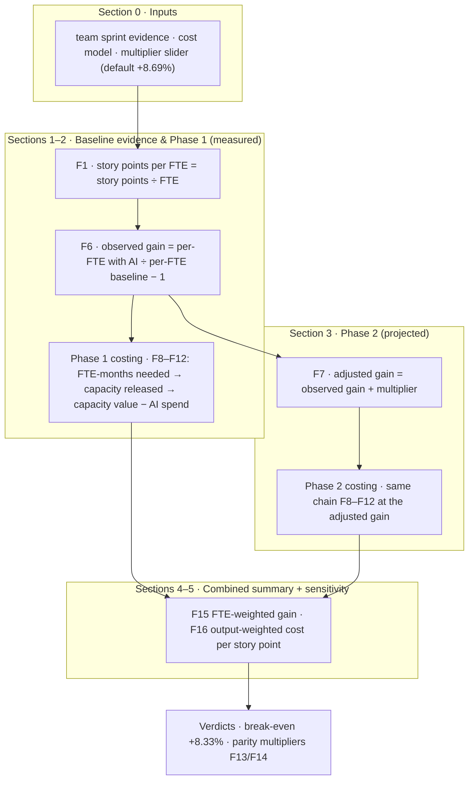

# AI Productivity & Cost-Reduction Calculator — User Guide

> **Tool:** `ai-two-team-evidence-dashboard.html` — two-team evidence edition
> **Edition:** 2 — euro (€) figures · "story points" terminology · default industry multiplier **+8.69%** (Accenture × GitHub RCT) · three collapsible reference sections · no implementation/amortization layer
> **Companion documents:** `AI_Two_Team_Evidence_Report.md` (the full evidence analysis) · this guide (fields, formulas, evidence and levers in business language)
> **Date:** October 26, 2026

---

## Contents

1. [What this calculator does](#1-what-this-calculator-does)
2. [The two-phase method](#2-the-two-phase-method)
3. [How a number travels through the tool](#3-how-a-number-travels-through-the-tool)
4. [Input reference — every field explained](#4-input-reference--every-field-explained)
5. [Output reference — every metric explained](#5-output-reference--every-metric-explained)
6. [The formulas in plain language](#6-the-formulas-in-plain-language)
7. [Verdicts — how the tool reads the result](#7-verdicts--how-the-tool-reads-the-result)
8. [Industry evidence behind the multiplier](#8-industry-evidence-behind-the-multiplier)
9. [What moves the needle most](#9-what-moves-the-needle-most)
10. [Assumptions and limitations](#10-assumptions-and-limitations)
11. [Frequently asked questions](#11-frequently-asked-questions)
12. [Files in this suite](#12-files-in-this-suite)

---

## 1. What this calculator does

This calculator turns delivery evidence into two business numbers: **productivity gain** (how much more each engineer delivers) and **cost reduction** (how many euros per month the organization saves, already net of the AI tool spend). It analyses two teams side by side — Team 1 and Team 2 — and rolls them up into a combined, one-page business view. Every figure is produced by a numbered, visible formula (F1–F16), so a non-technical stakeholder can trace any number on the screen back to the inputs that produced it. Nothing is hidden in a model: change any input and every table, both phases, the combined summary and the sensitivity grid recalculate instantly.

The tool is built around a simple, disciplined question: **what does it cost to deliver the same work?** All savings figures compare the *baseline monthly output* delivered at the *adjusted efficiency* against the *baseline monthly cost*. That framing keeps AI honest — a licence only creates savings when the per-FTE efficiency it buys exceeds the licence's share of the loaded cost (+8.33% at the default €1,200 labour + €100 seat price ratio). Capacity that AI frees up is expressed in FTE and in euros, and is treated as capacity to redeploy, not a headcount cut.

---

## 2. The two-phase method

The calculator deliberately separates what you **measured** from what you **project**:

**Phase 1 — evidence-based (measured).** Each team is observed in a without-AI baseline sprint and a with-AI sprint. Because headcount may move between the two states, productivity is normalized **per FTE** (story points per full-time engineer), and the observed gain is the change of that ratio. Phase 1 then prices the honest question: delivering the *baseline* monthly output at the *observed* efficiency — how many FTE-months does that need, what capacity is released, and what is the monthly cost reduction after paying the AI licence for the FTE-months actually needed? At the default evidence set, the answer is negative for both teams (combined −€1,438/month): the observed data alone does not yet support a savings claim, and the tool says so.

**Phase 2 — structured-pipeline projection.** Phase 2 is not "more of the same chat-window usage". It assumes AI is applied as a **disciplined pipeline**: work routed to where AI helps most, AI review and test generation as pipeline stages, standardized prompts, and per-FTE unit metrics tracked monthly. On top of each team's observed gain, an **industry-standard multiplier** is applied additively — **default +8.69%, the Accenture × GitHub enterprise RCT**, treated as the measured floor a structured programme should beat. At that default, the portfolio flips to +€157/month with 1.31 FTE of capacity released; the slider (0–30%) and the sensitivity grid show every other planning case.

Two phases, two messages: Phase 1 tells stakeholders *"here is what the data already shows"*, Phase 2 tells them *"here is what a structured programme should at minimum deliver, with the industry evidence to back it"*. Presenting them separately is what makes the combined story credible.

---

## 3. How a number travels through the tool

The whole calculation is one transparent chain. Follow a single number — Team 1's story-point total — from input to verdict:

In words, the six steps are: **(1)** normalize each observed sprint to story points per FTE; **(2)** take the ratio of the with-AI and baseline per-FTE rates to get the observed gain; **(3)** scale to the monthly operating unit (× sprints per month) and price it with the cost model; **(4)** run the same-output costing chain — FTE-months needed, capacity released, capacity value, AI spend, cost reduction — as Phase 1; **(5)** add the industry multiplier to the observed gain and re-run the identical chain as Phase 2; **(6)** roll both teams up (euros summed, percentages FTE-weighted) and read the verdicts against the +8.33% break-even. Every screen section corresponds to one of these steps, and every number carries the formula ID (F1–F16) that produced it.

---

## 4. Input reference — every field explained

The tool has exactly fourteen inputs, all in Section 0. Defaults reproduce the observed two-team evidence and the standard cost model.

| # | Field | Default | What it is and where to get it |
|---|-------|----------------------------------------|
| 1 | Team 1 name | Team 1 | Free text label; used in tables, KPIs and verdicts. |
| 2 | Team 1 · FTE before AI | 6.0 | Headcount in the baseline (without-AI) sprint. From your sprint tracking tool. |
| 3 | Team 1 · Story points before AI | 58.6 | Story points delivered in that baseline sprint. Use your team's own estimation, unchanged. |
| 4 | Team 1 · FTE with AI | 5.5 | Headcount in the observed with-AI sprint. |
| 5 | Team 1 · Story points with AI | 56.4 | Story points delivered in the with-AI sprint. |
| 6–10 | Team 2 · same five fields | 9.5 / 66.8 / 11.5 / 79.2 | Team 2's two observed states, same definitions. |
| 11 | Sprints per month | 2 | The operating unit of the cost model. Two-week sprints → 2. |
| 12 | Labor cost per FTE / month | €1,200 | Fully loaded monthly cost of one full-time engineer (salary + employer costs + overhead). |
| 13 | AI seat cost per FTE / month | €100 | Licence plus usage per AI-enabled engineer per month. |
| 14 | Industry multiplier (slider) | +8.69% | The Phase 2 uplift. Continuous 0–30% with quick-set stops: 8.69% (Accenture × GitHub RCT — default), 10% (Bain floor), 15% (conservative), 20% (band midpoint), 25% (Gartner floor), 30% (Bain ceiling). |

Three data-hygiene rules make the inputs trustworthy. First, the two states must be **like-for-like within each team**: same estimation practice, comparable scope mix. Second, per-FTE normalization requires honest FTE counts — include part-timers as fractions, not heads. Third, prefer multiple sprints averaged per state over a single sprint; the default evidence is one sprint per state and is treated as a direction, not a rate.

---

## 5. Output reference — every metric explained

| Metric (formula ID) | Plain-language meaning |
|---------------------|------------------------|
| Story points per FTE per sprint (F1) | How much one engineer delivers per sprint — the only fair comparison when headcount moves. |
| Observed gain per FTE (F6) | The measured productivity change between the with-AI and baseline states. |
| Monthly output (F2) | The baseline sprint's story points scaled to the month (× sprints per month). |
| Monthly cost (F3) | Baseline headcount × monthly labour cost — the baseline spend the scenarios compare against. |
| Productivity, story points/FTE/month (F4) | The monthly per-engineer rate; doubles the sprint rate at 2 sprints/month. |
| Cost per story point (F5) | The unit price of delivery: monthly cost ÷ monthly story points. The value metric. |
| Adjusted gain (F7) | Observed gain + industry multiplier — the Phase 2 projection. |
| FTE-months needed (F8) | Baseline headcount ÷ (1 + gain): how many engineer-months it takes to deliver the baseline output at the adjusted efficiency. |
| Capacity released (F9) | Baseline FTE minus FTE-months needed — the engineers' worth of capacity AI frees per month. |
| Capacity value (F10) | Capacity released × monthly labour cost — what that freed capacity is worth in euros. |
| AI tool spend (F11) | The licence cost of the FTE-months actually needed — charged against the savings, so every "cost reduction" figure is already net of tool cost. |
| Monthly cost reduction (F12) | Capacity value − AI tool spend: the headline savings number, same-output framing. |
| Break-even gain (F13) | (labour + seat) ÷ labour − 1 = +8.33% by default — the gain a team needs before the licence pays for itself. |
| Parity multiplier (F14) | Break-even − observed gain: the minimum industry multiplier each team needs to reach cost parity (Team 1 ≥ 3.3%, Team 2 ≥ 10.4% at defaults). |
| Combined % gain (F15) | FTE-weighted average of the two teams' gains (+9.4% at the default multiplier). |
| Combined € per story point (F16) | Output-weighted blended unit cost across both teams. |

With the default inputs, the headline outputs are: **Phase 1** — Team 1 −€229/month, Team 2 −€1,209/month, combined −€1,438/month (both teams below the +8.33% break-even); **Phase 2 at +8.69%** — Team 1 +€339/month, Team 2 −€182/month, combined **+€157/month** (+0.8% of the €18,600 baseline) with **1.31 FTE** released and a **+9.4%** combined adjusted gain.

---

## 6. The formulas in plain language

The full formula list lives in the tool's collapsible **Formula Reference** (Section 6 on the page) and in §7 of the companion report. In plain language:

- **F1 · Story points per FTE** — divide what the team delivered by the people who delivered it. This is the fair metric whenever headcount changes between the two states.
- **F2 · Monthly output** — baseline sprint story points × sprints per month. The cost model is monthly, so everything is scaled to the month.
- **F3 · Monthly cost** — baseline FTE × monthly labour cost. This is the reference spend.
- **F4 · Productivity** — monthly output ÷ baseline FTE: the per-engineer monthly rate.
- **F5 · Cost per story point** — monthly cost ÷ monthly output: the unit price of delivery, and the number that decides value.
- **F6 · Observed gain** — the with-AI per-FTE rate divided by the baseline per-FTE rate, minus one. Measured evidence only; no assumptions.
- **F7 · Adjusted gain** — observed gain + industry multiplier. Additive on purpose: compounding would flatter the projection by ~0.5 point at these magnitudes, and additive is the conservative choice.
- **F8 · FTE-months needed** — baseline FTE ÷ (1 + gain). How many engineer-months it takes to deliver the baseline output at the adjusted efficiency.
- **F9 · Capacity released** — baseline FTE minus FTE-months needed. The freed capacity, in FTE.
- **F10 · Capacity value** — capacity released × labour cost. What the freed capacity is worth in euros per month.
- **F11 · AI tool spend** — FTE-months needed × seat cost. The licence is charged only for the engineers actually needed, so savings are already net of tool cost.
- **F12 · Monthly cost reduction** — capacity value − AI tool spend (equivalently: baseline cost − FTE-months needed × (labour + seat)). The headline savings figure.
- **F13 · Break-even gain** — (labour + seat) ÷ labour − 1 = **+8.33%** at the default cost model. The licence is 8.33% of a €1,200 FTE, so per-FTE productivity must rise by at least that for the unit cost of a story point to stay flat.
- **F14 · Parity multiplier** — break-even − observed gain. The minimum multiplier each team needs to reach parity.
- **F15 · Combined gain** — FTE-weighted average across teams, so the bigger team moves the portfolio number proportionally.
- **F16 · Combined cost per story point** — output-weighted blend of the two teams' unit costs.

**Worked example (Team 1, default inputs).** Baseline: 6.0 FTE deliver 58.6 story points per sprint → 9.77 per FTE (F1). With AI: 5.5 FTE deliver 56.4 → 10.25 per FTE. Observed gain = 10.25 ÷ 9.77 − 1 = **+5.0%** (F6). Monthly output = 58.6 × 2 = 117.2 story points (F2); monthly cost = 6 × €1,200 = €7,200 (F3); cost per story point = €61.43 (F5). *Phase 1:* FTE-months needed = 6 ÷ 1.05 = 5.71 (F8) → capacity released 0.29 FTE (F9), worth €343 (F10); AI spend = 5.71 × €100 = €571 (F11) → monthly cost reduction = €343 − €571 = **−€229** (F12): a cost increase. *Phase 2 at +8.69%:* adjusted gain = 5.0% + 8.69% = **+13.7%** (F7) → FTE-months needed 5.28 → capacity released 0.72 FTE, worth €867; AI spend €528 → monthly cost reduction = **+€339**. Same chain, one extra assumption — that is the entire difference between "measured" and "projected".

---

## 7. Verdicts — how the tool reads the result

The tool refuses to let a positive portfolio number hide a losing team. Its verdict logic, computed live:

- **Break-even:** every scenario is compared against the **+8.33% break-even gain** (F13). Below it, the AI licence makes each story point more expensive; above it, cheaper.
- **Per-team parity (F14):** Team 1 needs a multiplier ≥ **3.3%**, Team 2 needs ≥ **10.4%** (defaults). The tool states, per team, whether the current multiplier clears that bar.
- **Portfolio truth:** at the +8.69% default the combined result is +€157/month — but the tool's verdict says *"combined covers the tool spend, one team does not yet"*: Team 1 +€339 above parity, Team 2 −€182 below it. Both teams clear parity from the 15% stop; at the 25% stop the combined saving is +€2,555/month.
- **Below break-even (Phase 1):** the tool says so in red — the evidence-based result at defaults is −€1,438/month combined, and no amount of narrative turns a measurement into a saving.

---

## 8. Industry evidence behind the multiplier

The default and the scenario band come from published measurements and analyst projections — each with its own caveat, which the tool's collapsible **Evidence & What Moves the Needle** section (Section 8 on the page) shows in full.

| Source | Figure | How it is used here |
|--------|--------|---------------------|
| **Accenture × GitHub RCT (2024)** | **+8.69% PRs per developer** | The **default multiplier** — enterprise randomized controlled trial, real repository, +15% merge rate, +84% build success. Treated as the measured floor for a structured rollout. |
| Bain Technology Report 2025 | 10–15% measured, up to 30% | 10% quick-stop ("Bain floor"); 30% stretch ("Bain ceiling"). |
| Gartner (2024–25) | 25–30% projected | 25% quick-stop ("Gartner floor") — the central planning case. |
| Capgemini Research Institute 2024 | 7–18% organization-level | Context band; confirms the floor sits below the analyst projections. |
| Microsoft field experiment 2024 (MIT reanalysis) | up to +22% PRs | Observational upper-middle band evidence. |
| GitHub Copilot RCT 2023 (Peng et al.) | 55.8% faster task completion | Small lab RCT on greenfield tasks — the task-level ceiling; cited as the upper bound, not a planning figure. |
| METR RCT 2025 | **−19%** (experienced devs, mature repos) | The caution: ad-hoc AI usage can slow experts who believe they are faster. The reason Phase 2 is a process change, not more chat. |
| DORA 2024 (39,000+ professionals) | individual productivity +2.1% per 25% adoption, throughput −1.5% | Adoption without delivery redesign does not raise throughput — the multiplier must be engineered. |
| DX 121,000-dev survey 2026 | ~10% plateau, ~4 h/week | Gains plateau without process change; supports the conservative default. |
| Duolingo × GitHub 2024 | review 3h → 1h; +25% for newcomers | Review and onboarding are the highest-leverage pipeline stages. |
| Meta TestGen-LLM 2024 | 73% of AI tests accepted | Test generation as a pipeline stage is production-proven. |
| McKinsey 2023–24 | docs 45–50%, code 35–45%, refactoring 20–30% time savings | Task-level bands; the source of "route work to where AI is strongest". |

The reading discipline: randomized measurements (Accenture × GitHub, Peng, METR) outrank analyst projections (Bain, Gartner, Capgemini); negative results (METR) are kept in view precisely because they define where the multiplier does **not** come from — unstructured usage on mature code by experts working alone.

---

## 9. What moves the needle most

Ranked by how much each lever moves the two outcomes (productivity gain and cost reduction). These are the levers that turn the Phase 1 result into the Phase 2 multiplier — the tool's numbers assume a programme that operates them.

1. **Route work to where AI is strongest.** Greenfield code, unit tests, documentation, review prep — segment tasks deliberately rather than by habit. Task-level evidence (35–55% time savings on these classes) is where the aggregate multiplier is earned.
2. **Make AI review a pipeline gate.** Review is the highest-leverage shared stage; measured review turnaround can drop from 3 hours to 1 (Duolingo). Automating it first benefits every developer at once.
3. **Generate tests as a CI stage.** AI-generated tests reach 73% acceptance in production (Meta); they convert raw AI speed into shippable speed and cut downstream debugging.
4. **Standardize prompts and playbooks.** Acceptance rate is the strongest predictor of realized productivity (Ziegler et al., CACM). Templates reduce variance across developers.
5. **Onboard deliberately; respect the expert trap.** Newcomers gain most (+25%); experts on mature code can go backwards (METR −19%). Assign AI-heavy flow to unfamiliar work; keep experts on routing and review.
6. **Redesign the process, not just the tool.** DORA: more AI adoption without delivery redesign slightly *reduced* throughput. The multiplier comes from changing the pipeline, not from buying seats.
7. **Measure unit economics monthly.** Track story points per FTE and cost per story point per sprint (the tool's F4/F5). Perception gaps (METR: felt +20%, measured −19%) only surface with unit metrics.
8. **Beat the measured floor deliberately.** +8.69% is a floor, not a target. Route work, gate reviews, generate tests, standardize prompts — and re-baseline every sprint.

---

## 10. Assumptions and limitations

The tool's collapsible **Assumptions** section (Section 7 on the page) lists ten assumptions (A1–A10); the load-bearing ones:

- **Same-output framing (A4):** every scenario delivers the baseline monthly output at adjusted efficiency; freed capacity is redeployed, not a headcount cut.
- **Additive multiplier (A5):** adjusted = observed + multiplier; conservative versus compounding by ~0.5 point.
- **Cost model (A2/A3):** €1,200 fully loaded labour and €100 AI seat per FTE-month, identical across states; break-even +8.33% follows from the ratio, not the absolute prices.
- **Rounding and combined rows (A6):** per-team euros are rounded; combined figures are exact sums of the rounded parts; combined percentages are FTE-weighted; combined cost per story point is output-weighted.
- **Evidence depth (A7/A8):** one sprint per team per state, confounded by concurrent staffing changes (Team 1 −0.5, Team 2 +2.0 FTE); treat observed results as directions, not rates.
- **Benchmarks are external (A9):** industry multipliers are planning evidence, not measurements of these teams.
- **Currency (A10):** figures display in euro; the arithmetic is currency-agnostic.

**Limitations to state when presenting:** story points are an output proxy, not a value measure; the model is linear per month (no ramp-up, rework or scope-mix simulation); the with-AI observation cannot separate AI from the staffing change; and the sensitivity grid spans 0–30% because anything above the published band is marketing, not planning. The honest presentation order is: measured first (Phase 1), projected second (Phase 2), with the break-even threshold and each team's parity multiplier stated explicitly.

---

## 11. Frequently asked questions

**Why euro? Does the tool work in another currency?** All labels and figures display in euro. The arithmetic is currency-agnostic: enter fully loaded cost and seat price in any currency and every figure updates consistently — the +8.33% break-even only depends on the *ratio* of seat price to labour cost.

**Why "story points" rather than hours?** Story points are the unit the teams already estimate and track; they are comparable within a team across states and avoid pretending that AI saves wall-clock hours (which METR showed can go backwards even when developers feel faster). Hours-based capacity fields (working hours per FTE, implementation one-time cost, amortization months) were removed in Edition 2 because the savings chain does not need them: FTE-months, not hours, are the cost model's unit.

**Our headcount did not change between the two states. Does the tool still work?** Yes — with constant FTE, the per-FTE gain reduces to the plain output ratio (story points with AI ÷ story points baseline − 1), and the rest of the chain is unchanged.

**Why is Phase 1 negative at the defaults?** Because the observed evidence shows both teams below the +8.33% break-even, and the tool refuses to hide that. A negative Phase 1 with a positive Phase 2 is a *credible* story: "today's ad-hoc usage has not paid for itself; the structured programme is what will."

**Can I add a third team?** Not in this edition — the tool is deliberately two-team with a combined view. Duplicate the file and analyse a second pair, or use the portfolio row as the aggregation point.

**How often should we re-baseline?** Every sprint, per the companion report's Recommendation 5: at least 3–4 sprints per state, constant estimation practice, before treating results as rates rather than directions.

**Why additive (g + m) rather than compounding (1+g)(1+m)?** At these magnitudes the difference is ~0.5 percentage point; additive is the conservative choice and easier to explain. The tool states this as assumption A5.

---

## 12. Files in this suite

| File | Role |
|------|------|
| `ai-two-team-evidence-dashboard.html` | The interactive calculator (this guide's subject). Open in any browser; no installation. |
| `AI_Two_Team_Evidence_Report.md` | The full evidence analysis: baseline data, per-FTE gains, cost impact, multiplier scenarios, findings and recommendations. |
| `AI_Two_Team_Calculator_Guide.md` | This guide: method, fields, outputs, formulas, evidence and levers in business language. |
| `ai-fte-productivity-calculator.html` · `AI_Productivity_Business_Case.md` · `AI_Productivity_Gain_Explained.md` / `.docx` | The related single-team FTE-calculator family and its documents (separate methodology; see `README.md`). |
| `ai-effort-reduction-estimator.html` · `AI_Effort_Reduction_From_Token_Usage_Market_Tools_and_Evidence.md` | Token-usage based effort-reduction estimation line. |
| `ai-time-savings-calculator.html` · `AI_Time_Savings_Evidence_Framework.md` · `ai-time-savings-research-compilation.md` · `AI_Time_Savings_Estimation_Report.pdf` · `AI_Time_Savings_Report_cover.html` | The time-savings research and estimation line. |
| `ai-productivity-explained.html` | Simplified explainer edition of the productivity-gain calculation. |

Start with the dashboard's defaults, replace the evidence fields with your own two teams' sprints, set the cost model to your finance department's figures, and let the slider do the stakeholder conversation.
